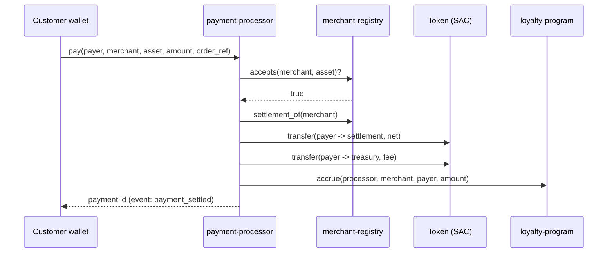

# StellarPOS Contracts

Soroban smart contracts for StellarPOS, a point-of-sale system for merchants
who accept payment on the Stellar network.

[](https://github.com/StellarPOS-App/contracts/actions/workflows/ci.yml)
[](https://codecov.io/gh/StellarPOS-App/contracts)


This repository is one of three:

| Repository | What it is |
|---|---|
| [`contracts`](https://github.com/StellarPOS-App/contracts) (this repo) | On-chain settlement, loyalty, treasury and escrow |
| [`backend`](https://github.com/StellarPOS-App/backend) | REST + WebSocket API: catalog, sales, checkout, payment matching |
| [`surface`](https://github.com/StellarPOS-App/surface) | The point-of-sale web app cashiers and managers use |

## The contracts

| Crate | Purpose | Key entry points |
|---|---|---|
| [`merchant-registry`](contracts/merchant-registry/src/lib.rs) | Who may get paid, where funds settle, which assets each merchant takes | `register`, `approve`, `suspend`, `accepts`, `settlement_of` |
| [`payment-processor`](contracts/payment-processor/src/lib.rs) | Atomic sale settlement: fee to treasury, net to merchant, one payment per order | `pay`, `pay_batch`, `pay_with_royalties`, `refund`, `payment_for_order`, `quote`, `propose_param_change` |
| [`loyalty-program`](contracts/loyalty-program/src/lib.rs) | Per-merchant points with automatic Bronze/Silver/Gold/Platinum tiers | `enroll`, `accrue`, `redeem`, `get_account` |
| [`treasury`](contracts/treasury/src/lib.rs) | M-of-N multisig that holds protocol fees and can put idle funds into approved yield vaults | `propose`, `approve`, `execute`, `freeze`, `vaults` |
| [`escrow-service`](contracts/escrow-service/src/lib.rs) | Held payments for deliveries and pre-orders, with dispute resolution | `create`, `release`, `claim`, `raise_dispute`, `resolve`, `resolve_by_default` |
| [`payment-stream`](contracts/payment-stream/src/lib.rs) | Per-second payment streams for subscriptions, rent and payroll; cancel splits earned and unearned exactly | `create`, `withdraw`, `cancel`, `available` |
| [`shared`](contracts/shared/src/lib.rs) | Library, not deployed: basis-point fee math and storage TTL helpers | `bps_of`, `split_fee`, `extend_*` |

### How a sale settles



All transfers happen inside one transaction, so either the whole sale settles
or nothing moves. The processor never holds customer funds, and the
`(merchant, order_ref)` pair is unique, so a retried checkout cannot charge
twice.

### Design rules

These hold across every contract:

- **Typed errors, no panics on user input.** Each contract has a
  `#[contracterror]` enum. Clients get a stable numeric code for every
  rejection.
- **Events for every state change**, defined with `#[contractevent]`, so the
  backend and indexers can follow everything without polling storage.
- **Emergency pause.** Registry, processor, loyalty and escrow can be paused
  by their admin. Escrow refunds still work while paused, because returning
  funds to a buyer is always safe. The treasury uses a multisig freeze
  instead.
- **Checked arithmetic.** Fee and split math goes through `shared::bps_of`,
  which returns `None` on overflow or on more than 100%.
- **TTL management.** Every read or write of a long-lived record extends its
  TTL, so active data is never archived.

More detail on each contract, including state machines and storage layout, is
in [docs/architecture.md](docs/architecture.md).

## Glossary

Point-of-sale terms used across the contracts and docs:

| Term | Meaning |
|---|---|
| **Merchant** | A business registered in `merchant-registry`. Only approved, active merchants can be paid. |
| **Settlement account** | The address a merchant's sales are paid into (can differ from the merchant's own address). Refunds are sent from it. |
| **Order reference (`order_ref`)** | The POS order number. Each merchant can be paid once per order reference, so a double-tapped "Pay" never charges twice. |
| **Settlement** | Completing a sale on-chain: the fee goes to the treasury and the net goes to the settlement account, in one transaction. |
| **Gross / net amount** | Gross is what the customer pays; net is what remains after the protocol fee. |
| **Basis points (bps)** | Hundredths of a percent: 100 bps = 1%, 10,000 bps = 100%. Fees and splits are set in bps. |
| **Protocol fee (`fee_bps`)** | The platform's cut of each sale, capped at 10% (`MAX_FEE_BPS`), paid to the treasury. |
| **Royalty split** | Extra recipients (artists, referrers) paid a bps share of the net amount on a marketplace sale; the seller gets the rest. |
| **Quote** | A preview of the fee/net split for an amount, shown at checkout before paying. |
| **Batch payment** | Several orders paid by one customer in one all-or-nothing transaction (`pay_batch`). |
| **Refund (partial / full)** | Money sent back from the settlement account to the payer, up to the gross amount. Fees and royalties are not returned. |
| **Treasury** | The M-of-N multisig contract that holds protocol fees. |
| **Escrow** | A payment held by the contract until delivery: released by the buyer or claimable by the seller after `release_at`. |
| **Release time (`release_at`)** | When escrowed funds become claimable by the seller; buyers can open a dispute until then. |
| **Dispute / arbitration window** | A dispute freezes an escrow; the arbiter must rule within the arbitration window or a default rule resolves it. |
| **Payment stream** | Money paid per second (subscriptions, rent, payroll); cancelling splits earned and unearned amounts exactly. |
| **Loyalty tier** | Bronze, Silver, Gold or Platinum: a customer's level with a merchant, which boosts points earned. |
| **Governance council** | Once enabled, the members who must approve fee-rate and treasury changes instead of the admin alone. |
| **TTL / bump** | Soroban storage expires unless extended; contracts bump records whenever they are read or written. |

Escrow seller payouts have a one-hour minimum lock by default. The admin can
set a longer minimum with `set_min_lock_period(seconds)`. New escrows record the
policy at funding and require `release_at` at or after the lock ends. Buyer-only
refunds can return funds before unlock. Each escrow pays out in the asset it
recorded at funding. Merchant registration leaves payment statistics absent
until the first successful payment. The payment count reads as zero in the meantime.


## Getting started

### Prerequisites

- Rust stable with the `wasm32v1-none` target (pinned in
  [`rust-toolchain.toml`](rust-toolchain.toml), installed automatically by
  rustup)
- [Stellar CLI](https://developers.stellar.org/docs/tools/cli) 23 or newer,
  for building optimized wasm and deploying

### Build and test

```bash
git clone https://github.com/StellarPOS-App/contracts.git
cd contracts

make test      # 63 tests across all crates
make check     # rustfmt + clippy -D warnings + tests (what CI runs)
make build     # optimized wasm in target/wasm32v1-none/release/
make sizes     # wasm sizes, all well under the 64 KB limit
make verify    # check a deployment runs exactly this source (NETWORK=testnet)
```

### Deploy to testnet

```bash
make deploy                      # NETWORK=testnet, FEE_BPS=100 by default
NETWORK=testnet FEE_BPS=250 make deploy
```

[`scripts/deploy.sh`](scripts/deploy.sh) creates and funds a deployer
identity if needed, deploys all five contracts, initializes them, connects
the loyalty program to the processor, and writes every contract ID to
`deployments/<network>.json`. See [docs/deployment.md](docs/deployment.md)
for the post-deploy checklist (multisig rotation, merchant onboarding) and
example `stellar contract invoke` calls.

## Project layout

```
contracts/
  shared/               fee math and TTL helpers (rlib)
  merchant-registry/
  payment-processor/
  loyalty-program/
  treasury/
  escrow-service/
    src/dispute.rs      dispute reasons, role rules, default rulings
    tests/              end-to-end dispute scenarios
docs/                   architecture and deployment guides
scripts/deploy.sh       deploy + initialize + wire
deployments/            contract IDs per network (written by deploy.sh)
```

## Contributing

Read [CONTRIBUTING.md](CONTRIBUTING.md). In short: open an issue first for
anything non-trivial, keep pull requests focused, and run `make check`
before pushing. Security issues go through [SECURITY.md](SECURITY.md), never
public issues.

## License

[MIT](LICENSE)
