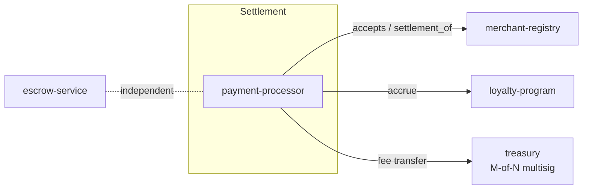
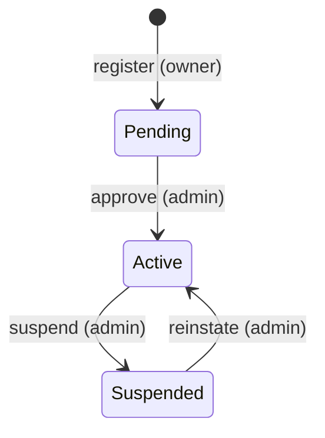
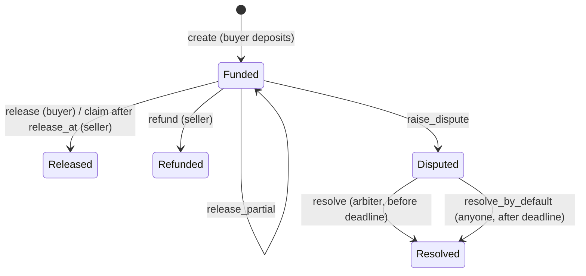

# Contract architecture

This document describes each contract's responsibilities, state, and
lifecycle. Read the README first for the overview.

## Contract graph



- The **payment processor** is the only contract that calls others. It reads
  the registry and, when configured, calls the loyalty program.
- The **loyalty program** accepts `accrue` only from the merchant itself or
  from a processor on its allowlist (`add_processor` / `remove_processor`,
  at most 5). Several processors can be allowed at once, so a new one can
  go live before the old one is retired, and revocation takes effect
  immediately. When a processor calls, Soroban authorizes the calling
  contract automatically.
- The **treasury** is just a recipient from the processor's point of view. It
  never calls out except to pay approved withdrawals.
- The **escrow service** is standalone. It is used for orders that are not
  completed at the counter.

## merchant-registry

**State**

| Key | Storage | Value |
|---|---|---|
| `Admin`, `Paused`, `MerchantCount` | instance | config |
| `Merchant(owner)` | persistent | `Merchant { owner, name, settlement, accepted_assets, status, registered_at, updated_at }` |

**Lifecycle**



`accepts(owner, asset)` is true only for `Active` merchants that list the
asset. Accepted assets are capped at 10 and must be unique, which keeps the
check cheap.

## payment-processor

**State**

| Key | Storage | Value |
|---|---|---|
| `Config` | instance | `admin, registry, treasury, fee_bps, loyalty, paused` |
| `PaymentCount` | instance | last payment id |
| `Payment(id)` | persistent | full payment record |
| `Order(merchant, order_ref)` | persistent | payment id (the idempotency index) |

**Fees.** `fee = amount * fee_bps / 10_000`, rounded toward zero, capped at
`MAX_FEE_BPS = 1000` (10%). `quote(amount)` returns `(fee, net)` for checkout
previews.

**Refunds** are authorized by the payment's settlement account, because that
account holds the funds. A refund can be partial and repeated, up to the gross
amount. The treasury does not return its fee on refunds, so the merchant
absorbs it. That is standard card-network behavior, and it stops refunds
being used to drain the treasury.

**Status:** `Completed`, then `PartiallyRefunded`, then `Refunded`.

## loyalty-program

Points per sale are calculated as:

```
base   = amount * points_per_unit / unit
points = base * tier_multiplier_bps / 10_000
```

`unit` is the asset's whole-unit size in stroops (`10_000_000` for standard
7-decimal assets). The tier comes from lifetime points before the sale:

| Tier | Lifetime points | Multiplier |
|---|---|---|
| Bronze | 0 | 1.00x |
| Silver | 1,000 | 1.10x |
| Gold | 5,000 | 1.25x |
| Platinum | 20,000 | 1.50x |

Redemption lowers `points` but never `lifetime`, so spending points never
costs a customer their tier. `redeem` needs signatures from both the
customer, who consents to spending, and the merchant, who commits to
honoring the discount.

## treasury

Every change is a proposal:

| Action | Effect on execute |
|---|---|
| `Withdraw(token, to, amount)` | Pays out. Blocked while frozen. |
| `AddSigner(addr)` | Max 10 signers, no duplicates |
| `RemoveSigner(addr)` | Rejected if signers would drop below threshold |
| `SetThreshold(n)` | `1 <= n <= signers` |
| `Unfreeze` | Clears an emergency freeze |

- Execution counts approvals only from **current** signers, so a removed
  signer's earlier approvals stop counting.
- Proposals expire 7 days after creation.
- `freeze` needs one signer, while `Unfreeze` needs the full threshold.
  Halting withdrawals is cheap; resuming them takes consensus.

## escrow-service



**Dispute rules** ([`src/dispute.rs`](../contracts/escrow-service/src/dispute.rs)):

| Reason | Who may raise | Default buyer share |
|---|---|---|
| NonDelivery, NotAsDescribed, Defective, WrongItem | Buyer | 100% |
| LateDelivery | Buyer | 50% |
| BuyerUnresponsive | Seller | 0% |
| Other | Either | 50% |

- Buyers must dispute before `release_at`. After that, the seller can claim.
- The arbiter has `arbitration_window` seconds (1 hour to 30 days, set when
  the escrow is created) to rule with any split in basis points.
- After the deadline, anyone can call `resolve_by_default`, so funds can never
  be stranded by an absent arbiter.
- Evidence is a list of up to 10 SHA-256 hashes of off-chain files per
  escrow. No personal data is stored on-chain.

## Error codes

Each contract numbers its errors from 1. Clients should map them by contract.
For example, `PaymentError::DuplicateOrder = 7` means "this order was already
paid", and the backend turns it into an HTTP 409. The full enums are at the
top of each `lib.rs`.

## Upgrades

The contracts do not include an upgrade entry point yet. Redeploying means
deploying new contracts and re-pointing the processor through `set_treasury`,
`set_loyalty`, and the backend configuration. Adding
`update_current_contract_wasm`, gated by the treasury multisig, is tracked
as future work.
